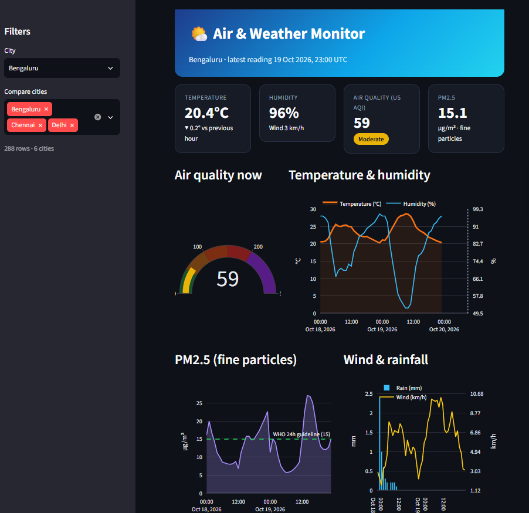

# Weather & Air Quality ETL Pipeline


An end-to-end data engineering project: it pulls hourly weather and air-quality
data for several cities from free public APIs, validates it, and loads it into a
DuckDB warehouse that powers a Streamlit dashboard.

## Architecture

```
Open-Meteo APIs -> Extract (raw JSON, partitioned by date)
                -> Transform (pandas: clean, rename, join weather + air quality)
                -> Quality checks (fail the run on bad data)
                -> Load (DuckDB, idempotent upsert)
                -> Streamlit dashboard
```

## Tech stack
Python, pandas, DuckDB, Streamlit, pytest, requests

## Key engineering features
- **Raw data layer:** original API responses are stored untouched in `data/raw/<date>/`
- **Retries with backoff** on API failures
- **Idempotent loads:** composite primary key (city, observed_at) + upsert, so re-running never duplicates rows
- **Data quality gate:** nulls, duplicates, and out-of-range values stop the pipeline before bad data reaches the warehouse
- **Unit tests** for transform, quality checks, and load idempotency

## How to run
```bash
python -m venv .venv
source .venv/bin/activate        # Windows: .venv\Scripts\activate
pip install -r requirements.txt

python run_pipeline.py           # runs extract -> transform -> check -> load
streamlit run dashboard.py       # opens the dashboard
pytest                           # runs the tests
```

## Project structure
```
pipeline/
  config.py      cities, API URLs, paths
  extract.py     download raw JSON
  transform.py   clean and combine
  quality.py     data validation
  load.py        write to DuckDB
run_pipeline.py  runs all steps in order
dashboard.py     Streamlit app
tests/           pytest tests
```

## What I would do at larger scale
- Store raw files in S3 / cloud storage and use Spark or dbt for transforms
- Orchestrate with Airflow or Dagster instead of a single script
- Load into BigQuery / Snowflake / Redshift
- Add alerting on failed runs

## Data source
[Open-Meteo](https://open-meteo.com/) (free, no API key needed).
